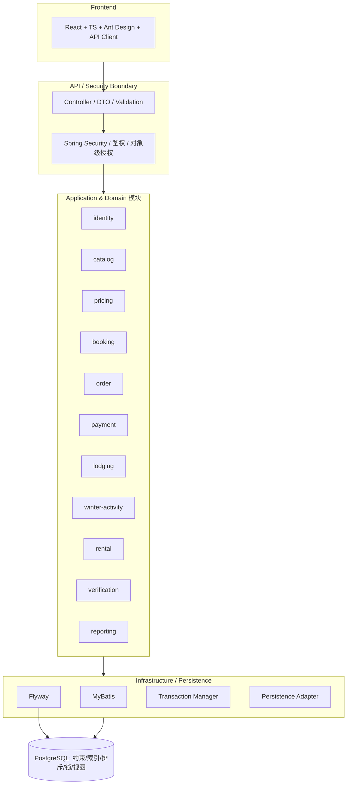
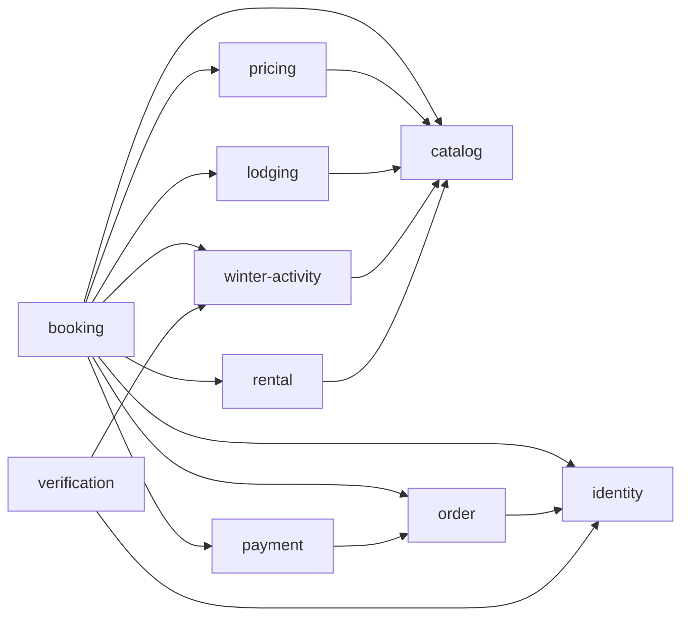
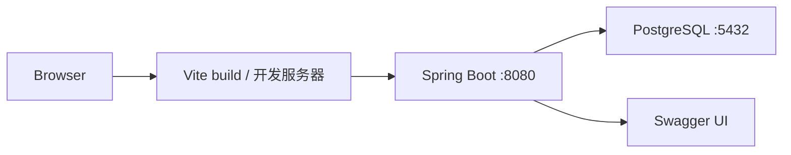

# 系统架构与功能模块

状态：架构设计 v2（2026-11-26 按项目负责人架构审查意见修订）。本文件是**工程设计文档**，不是三份公共契约（DB/API/ENUM）；契约仍为 `v1.0-rc`，正式冻结由 PR #2 完成。ADR 采用追加式记录，ADR-001~005 原始决策保持不变，本次新增 ADR-006~012。

---

## 0. 架构总览



架构模式：**模块化单体（Modular Monolith）**。单个 Spring Boot 进程 + 单个 PostgreSQL，按业务领域分包，模块间只通过公开接口协作，不使用微服务、注册中心、消息队列或分布式事务。

---

## 1. 模块内四层结构（每个业务模块通用）

```
<module>
├── api                        # 对外暴露：Controller + Request/Response DTO + 校验
├── application                # 用例编排 + @Transactional + 输入/输出端口(port)
├── domain                     # 纯业务规则：状态机、领域对象、值对象、规则
└── infrastructure
    └── persistence            # Mapper + MyBatis XML + Adapter(实现 port) + Record
```

### 1.1 依赖方向（只允许从上往下）

```
api ──► application ──► domain          （业务调用方向）
application ──► port（本模块定义的接口）  （依赖倒置）
infrastructure.persistence ──► 实现 port
```

### 1.2 依赖规则表（ArchUnit 强制，非口头约定）

| # | 规则 | 判定 |
|---|---|---|
| R1 | `api → application` | ✅ 允许 |
| R2 | `application → domain` | ✅ 允许 |
| R3 | `application → 本模块 port` | ✅ 允许 |
| R4 | `infrastructure.persistence → 实现 port` | ✅ 允许 |
| R5 | `api → infrastructure.persistence`（Controller 碰 Mapper） | ❌ 禁止 |
| R6 | `api → domain 内部对象`（Controller 绕过 DTO 直接用领域对象） | ❌ 禁止 |
| R7 | `domain → infrastructure` | ❌ 禁止 |
| R8 | `domain → api` | ❌ 禁止 |
| R9 | `domain → Spring/MyBatis/HTTP/Jakarta`（领域层依赖框架） | ❌ 禁止 |
| R10 | `模块 X → 模块 Y 的 infrastructure.persistence` | ❌ 禁止 |
| R11 | `模块 X → 模块 Y 的 domain 内部实现` | ❌ 禁止 |
| R12 | `模块 X → 模块 Y 的公开 application api`（按 §2 依赖图） | ✅ 允许 |
| R13 | `模块 X → 模块 Y 的 api 层 Controller` | ❌ 禁止 |

这些规则由 `ArchUnit` 架构测试在每次构建时自动检查（`ArchitectureTest`），违规即构建失败，不依赖 Review 人工发现。

### 1.3 可见性约束

- 模块对外只暴露 `api`（DTO）与 `application`（端口/用例）两个包；`domain` 与 `infrastructure` 是内部实现。
- 内部实现类尽量使用包级（default）访问权限，不 `public` 暴露给外部模块。
- 不为了"依赖倒置"给每个简单 CRUD 都建五层抽象：**只有跨模块协作或含明确业务不变量、需要测试替换的持久化操作才定义 port**；普通查询直接由 application 调用本模块 `infrastructure` 的 Adapter/Mapper。

---

## 2. 业务模块与依赖图（11 个逻辑模块）

> 11 个逻辑模块 ≠ 11 个 Maven 子项目，也不要求第一天全部创建。`admin` 不是业务领域（见 ADR-007），管理端路径 `/admin/**` 归属真正拥有该数据的模块。

| 模块 | 职责 | 拥有数据 |
|---|---|---|
| `identity` | 用户、角色、登录、认证、授权 | `app_user/role/user_role` |
| `catalog` | 营地、资源类型、具体资源、开放规则、季节、维修 | `campground/resource_type/resource_unit/resource_open_rule/resource_maintenance/season/holiday` |
| `pricing` | 价格规则、套餐目录、报价计算、冲突检测 | `price_rule*/package_offer/package_component` |
| `booking` | 预订编排 + 可用性查询（**跨模块用例编排与事务入口**） | 无自有主数据，聚合读 |
| `order` | 订单主表、明细、状态历史、成交价格快照 | `customer_order/order_item/order_package/price_snapshot_line/*_status_history` |
| `payment` | 模拟支付、支付尝试、幂等、退款模拟 | `payment` |
| `lodging` | 住宿/日营占用、区间冲突 | `lodging_reservation` |
| `winter-activity` | 滑雪票、课程场次、缆车时段与容量（`ski`/`lift` 子包） | `ski_product/ski_session/ski_booking/lift/lift_slot/lift_booking` |
| `rental` | 装备型号、单件资产、批量库存、租赁、归还、维修、库存流水 | `equipment_*/inventory_movement` |
| `verification` | 核销码、核销事件、一次性消费、防重复核销 | `verification_token/verification_event` |
| `reporting` | 营业额/订单/库存/利用率统计，只读查询 | 视图 `v_*` |

### 2.1 模块依赖图（单向，无环）



依赖方向语义（`A → B` 表示 A 可 import B 的公开 `application` api）：

- **`booking` 是唯一编排中心**，只依赖他人，不被任何人依赖；负责把 catalog/pricing/order/payment/lodging/winter-activity/rental 组合成完整预订用例。
- `order` 只负责订单本身；`lodging/winter-activity/rental` 只负责各自资源占用，**通过值参数（如 `orderItemId`）关联订单，不 import `order` 的 Java 类**（数据库外键 ≠ Java 依赖）。
- `payment` 只记录支付尝试与结果，订单状态的确认由 `booking` 协调，避免 `order ↔ payment` 互调。
- `reporting` 只读数据库视图，不 import 任何业务模块的 Mapper。
- 消除旧方案中 `order ↔ lodging/ski/lift/equipment` 的循环依赖。

### 2.2 数据所有权表

| 数据表/内容 | 唯一归属模块 |
|---|---|
| `app_user`、`role`、`user_role` | `identity` |
| 营地、资源类型、资源单元 | `catalog` |
| 开放规则、季节、维修记录 | `catalog` |
| `price_rule`、`package_offer`、`package_component` | `pricing` |
| `customer_order`、`order_item`、价格快照、状态历史 | `order` |
| `payment` | `payment` |
| `lodging_reservation` | `lodging` |
| 滑雪产品、课程、缆车时段与预约 | `winter-activity` |
| 装备资产、租赁、库存流水 | `rental` |
| 核销令牌、核销事件 | `verification` |
| 聚合统计视图 | `reporting` |

**规则**：表由唯一归属模块负责写入（通过其 application 用例）；其他模块需要数据时，只能通过该模块的公开查询接口，**不得直接读写其 Mapper**。数据库外键跨模块是数据完整性关系，不等于代码可以跨模块调用。

---

## 3. 分层职责（修正后）

| 层 | 职责 | 禁止 |
|---|---|---|
| `api`（Controller + DTO） | HTTP 协议、DTO 映射、Bean Validation、鉴权入口 | 不写业务规则、不碰 Mapper、不直接用领域对象 |
| `application`（用例 + 端口） | 用例编排、`@Transactional` 边界、权限上下文、输入输出端口 | 不知道 SQL/XML 如何实现 |
| `domain`（业务规则） | 价格计算、状态机、可用性判断、值对象 | 不依赖 Spring/MyBatis/HTTP/DB |
| `infrastructure.persistence`（Adapter + Mapper + XML） | 参数化 SQL、结果映射、实现 port | 不承载跨模块状态机 |
| PostgreSQL | 约束、排斥约束、部分唯一索引、行锁、触发器、视图 | — |
| Frontend | 呈现与交互 | 不决定成交金额、库存、权限 |

---

## 4. 安全架构（Security Architecture）

安全不等同于"Spring Security + JWT"，按以下分层落地：

| 范围 | 设计 | 优先级 |
|---|---|---|
| 密码存储 | Argon2id（或恰当参数的 BCrypt），不存明文/可逆哈希，不用 SHA-256 | P0 |
| 认证 | Spring Security；JWT 短时效 access token（30 分钟，无 refresh，v1） | P0 |
| 角色授权 | 仅 `CUSTOMER`/`ADMIN` 两类（冻结 ENUMS），`/admin/**` 要求 ADMIN | P0 |
| 对象级授权 | 用户只能访问/操作自己的订单、预订；服务端二次校验所有权，不能只靠前端隐藏 | P0 |
| 管理接口 | 默认拒绝；`@PreAuthorize`/路径规则 + 服务层双检 | P0 |
| SQL 安全 | MyBatis 一律 `#{}` 参数绑定；禁止不受控 `${}`；排序字段/列名/表名白名单 | P0 |
| 敏感信息 | 密码、JWT 密钥、DB 密码从环境变量读取，不入 Git、不入日志 | P0 |
| 核销安全 | 高随机性核销码；DB 只存哈希摘要；一次消费（事务锁+部分唯一索引）；防重放（幂等键+请求指纹）；记录操作者/时间/结果 | P0 |
| 错误信息 | 统一错误结构，不泄漏堆栈/SQL/内部路径；数据库唯一/排斥约束映射为稳定业务错误码 | P0 |
| 审计日志 | 价格修改、订单取消、人工支付、核销等敏感操作留痕 | P1 |
| 登录保护 | 失败次数限制、必要频率限制 | P1 |
| CORS/CSRF | 仅允许配置的前端源；按 Token 传输方式选择 CSRF 策略，不开放任意域名 | P1 |

对象级授权示例：`GET /orders/{id}` 必须校验该订单属于当前用户或当前用户为 ADMIN，不能仅凭"已登录"就放行。

---

## 5. 事务架构

跨模块协作事务由 **`BookingApplicationService`**（`booking` 模块）统一开启：

```text
BookingApplicationService
    │ @Transactional（单数据源，同一事务管理器）
    ├── PricingApplicationService.quote(...)       # 报价重算
    ├── OrderApplicationService.create(...)        # 订单/明细/快照
    ├── LodgingApplicationService.hold(...)        # 住宿占用
    ├── WinterActivityApplicationService.reserve(...) # 容量扣减
    ├── RentalApplicationService.allocate(...)     # 装备库存
    └── PaymentApplicationService.pay(...)         # 支付（下单后独立用例）
```

- 各模块的 application 用例以 `REQUIRED` 传播参与调用方事务，自身不强制开新事务。
- **固定锁顺序**：住宿 `resource_unit_id` 升序 → 滑雪场次 → 缆车时段 → 批量装备 `model_id` → 单件资产 `asset_id`，降低死锁。
- **可用性查询 ≠ 库存锁定**：查询结果仅供参考，最终以数据库约束/行锁/原子条件更新为准。
- 业务规则主要在 `domain`/`application`；数据库函数**只在有明确性能或原子性理由时**引入，且必须单独测试，不得在 Java 与存储过程中重复实现同一套报价/状态规则。

---

## 6. 数据访问设计（MyBatis 边界）

- MyBatis 全部限制在 `<module>/infrastructure/persistence` 下：
  ```
  persistence/
    mapper/     OrderMapper.java + OrderMapper.xml
    adapter/    OrderRepositoryAdapter.java   # 实现 application 层定义的 port
    record/     OrderRecord.java              # 表行对象，非 API 响应对象
  ```
- 其他模块禁止 `import ...infrastructure.persistence.*`；跨模块查询走公开查询接口或只读视图。
- SQL：`#{}` 参数绑定；复杂 SQL/多表 JOIN 放 XML；结果用 `Record`，再由 `application` 映射为响应 DTO。
- 事务由 `application` 层声明，Mapper 不声明事务。
- 可复用规则（计价、状态机、可用性）收敛到 `domain`，避免多个 Service 重复实现。

---

## 7. 时间语义（细化）

- 业务时区 `Asia/Shanghai`，但**数据库时刻一律 `timestamptz`（绝对时刻）**，不以 JVM/连接时区改变绝对时刻。
- 类型选择：
  - 住宿按**入住日/退房日**计 → `daterange`（半开 `[入住日, 退房日)`）。
  - 精确到小时的预约（缆车时段、装备租赁）→ `tstzrange`。
  - 开放规则的墙上时钟（09:00 开门）→ `time` 类型 + 业务日期 + `Asia/Shanghai` 解释，**不用带时区时间戳**。
- Java 类型：`Instant`（timestamptz 读写基础）、`LocalDate`（业务日期）、`OffsetDateTime`（API 边界序列化）；`LocalDateTime` 仅在确无时区语义时使用，否则禁用。
- API 时刻带偏移（ISO-8601），`LocalDate` 用 `YYYY-MM-DD`；JDBC 会话时区仅用于 `date/time` 与本地换算，不改变 `timestamptz` 绝对值。
- 不把"设置 Jackson 时区"当作解决所有数据库时区问题的手段。

---

## 8. 测试架构

- **架构测试**：ArchUnit 强制执行 §1.2 的 R1~R13，违规即构建失败。
- **单元测试**：`domain` 业务规则、价格计算、状态机、参数边界、异常处理（纯 JUnit，无 DB）。
- **Web/API 测试**：DTO 校验、状态码、统一错误响应、权限控制（`@AutoConfigureMockMvc`）。
- **数据库集成测试**：真实 PostgreSQL（Testcontainers 或独立测试库），覆盖 Flyway 空库迁移、MyBatis 查询、主外键/唯一/检查约束、时间区间冲突、事务回滚。
- **并发测试**：住宿并发预订、容量并发扣减、订单幂等、装备库存并发变化；**必须使用独立数据库事务模拟多个用户**，不能用一个测试事务模拟并发；开发库与测试库隔离，测试不得污染开发库。
- 验收证据：真实命令 + 输出摘要 + 退出码；`NOT RUN` 不可写成 PASS；`contextLoads` 仅作为最小构建门禁，不作为业务/数据库验收。

---

## 9. 技术版本兼容矩阵（2026-11-26 核实）

| 组件 | 采用版本 | 兼容依据 | 说明 |
|---|---|---|---|
| Spring Boot | **4.1.3** | 官方 4.1 线最新补丁（2026-11-20）；OSS 支持至 2027-07 | 需真实构建验证 |
| Java | 21（LTS） | Boot 4.1 要求 17+，21 推荐 | 本机 21.0.12 |
| mybatis-spring-boot-starter | **4.1.0** | 官方声明：master → Boot 4.1、MyBatis 3.5、MyBatis-Spring 4.1、Java 17+ | 2026-07-16 发布 |
| MyBatis | 3.5.x（starter 传递） | starter 4.1 传递 | 不手写版本 |
| PostgreSQL JDBC | 42.7.x（BOM） | Boot 4.1 BOM 管理 | runtime |
| Flyway | BOM 管理 + `spring-boot-starter-flyway` + `flyway-database-postgresql` | Boot 4.1 需显式 flyway starter | S3 引入 |
| Spring Security | **7.1.3**（Boot BOM） | Boot 4.1.3 管理 | S4 已引入；JWT Resource Server/HS256 真实构建与 HTTP 测试通过 |
| springdoc-openapi | **3.2.0** | 父 POM 为 Boot 4.1.2，与本项目 4.1.3 同代；**3.2.1 起父 POM 已是 Boot 4.2.0，升级前必须重新核对父 POM 的 Boot 版本**（ADR-012 禁 Boot 4.2） | S2 引入（3.2.0） |
| ArchUnit | 1.4.1（若构建报错再升 1.5） | 独立库，JUnit 5 引擎 | S1 引入 |
| Maven Wrapper | 3.9.16 | 本机已缓存 | S1 生成 |
| PostgreSQL 镜像 | postgres:16-alpine | PG16 支持至 2028，容器已运行 | 保留 |

> 注意事项：Boot 4.x 的 starter 已改名（`spring-boot-starter-web` → `spring-boot-starter-webmvc` 等），测试用 `@MockitoBean` 替换 `@MockBean`，MockMvc 需 `@AutoConfigureMockMvc`，Jackson 升级为 3（`tools.jackson`）。MyBatis 4.1 与 Boot 4.1 的迁移**必须通过真实构建与集成测试验证**，不以版本号相符即宣告兼容。

---

## 关键架构决定（ADR）

### ADR-001 单体模块化

两人课程设计采用单体 Spring Boot + 单 PostgreSQL。模块通过包和服务边界分离，不使用微服务、Redis或队列。

### ADR-002 统一订单，不使用万能资源外键

`customer_order/order_item` 提供统一购物车和一次付款边界；一个订单可包含多间住宿、套餐和单选商品。住宿、票务、课程、缆车和装备各有带真实外键的占用表，套餐通过成交快照归组订单项。避免 `resource_type + resource_id` 无法建立外键，同时避免多个订单体系。

### ADR-003 两类库存

- 单件资源（木屋、营位、具体装备资产）：时间区间排斥约束。
- 容量资源（票、课程、缆车时段、批量装备）：锁定容量/库存行后累计数量。

### ADR-004 价格策略可解释

不照搬复杂实时AI/占用率定价。第一版使用可配置规则和明确优先级；每个价格分量形成快照。

### ADR-005 时间语义

业务时区固定 `Asia/Shanghai`；API时刻带偏移；数据库时刻用 `timestamptz`。住宿和资产使用半开时间范围，按自然日计价时保存 `service_date`。

### ADR-006 模块内四层 + 依赖倒置（新增）

每个业务模块内部按 `api / application / domain / infrastructure.persistence` 四层组织；`application` 依赖自声明的端口，`infrastructure` 实现端口。分层违规由 ArchUnit 自动检查（R1~R13）。只对跨模块协作或含业务不变量的持久化操作定义端口，简单 CRUD 保持简洁。

### ADR-007 重组为 11 个业务模块，消除循环依赖（新增）

- 删除顶层 `admin` 模块：管理端是访问入口，代码归属真正拥有数据的业务模块。
- `ski`+`lift` 合并为 `winter-activity`；`availability` 合并进 `booking`（作为查询能力）；`equipment` 改名 `rental`（业务是租赁，不只是目录）。
- `booking` 作为唯一编排中心，只依赖他人、不被依赖；`order/lodging/winter-activity/rental/payment` 不互相 import 内部实现，从根上消除 `order ↔ 资源模块` 循环。

### ADR-008 数据所有权唯一归属（新增）

每张业务表唯一归属一个模块；其他模块经该模块公开查询接口取数，禁止跨模块直接读写 Mapper。数据库外键跨模块与 Java 代码依赖分离。

### ADR-009 跨模块事务由 BookingApplicationService 编排（新增）

跨模块用例由 `booking` 的 `BookingApplicationService` 开启 `@Transactional` 统一编排，各模块用例以 `REQUIRED` 传播参与同一事务；固定锁顺序降低死锁；可用性查询不作为库存锁定的最终依据。

### ADR-010 安全架构（新增）

采用 §4 安全架构：Argon2id 密码、短时效 JWT、CUSTOMER/ADMIN 角色 + 对象级授权、管理接口默认拒绝、`#{}` 参数绑定、敏感信息环境变量、核销码哈希与一次性消费、审计留痕、统一错误不泄漏内部细节。

### ADR-011 时间语义细化（新增）

区分 `daterange`（按日住宿）、`tstzrange`（按小时预约）、`time`（墙上时钟开放规则）；数据库时刻统一 `timestamptz`；Java 侧 `Instant/LocalDate/OffsetDateTime` 各司其职，禁用有歧义的 `LocalDateTime` 用于业务时刻。

### ADR-012 技术栈基线迁移到 Spring Boot 4.1 + MyBatis 4.1（新增）

弃用已 EOL 的 Spring Boot 3.4.5/3.5.x；采用 Spring Boot 4.1.3 + mybatis-spring-boot-starter 4.1.0（官方声明兼容配对）+ Java 21 + PostgreSQL 16 + Flyway。锁定前须通过真实构建与集成测试验证，不用 Boot 4.2（MyBatis 尚未官方声明兼容）。

---

## 部署视图



推荐：PostgreSQL 用 Docker（命名卷持久化），后端本机运行；最终可增加全栈 Compose，但不作为第一阶段要求。开发库、测试库、演示数据边界明确。
